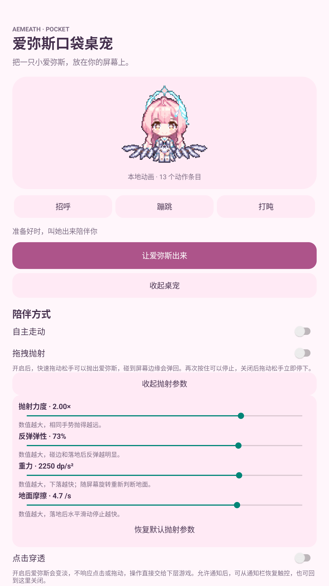
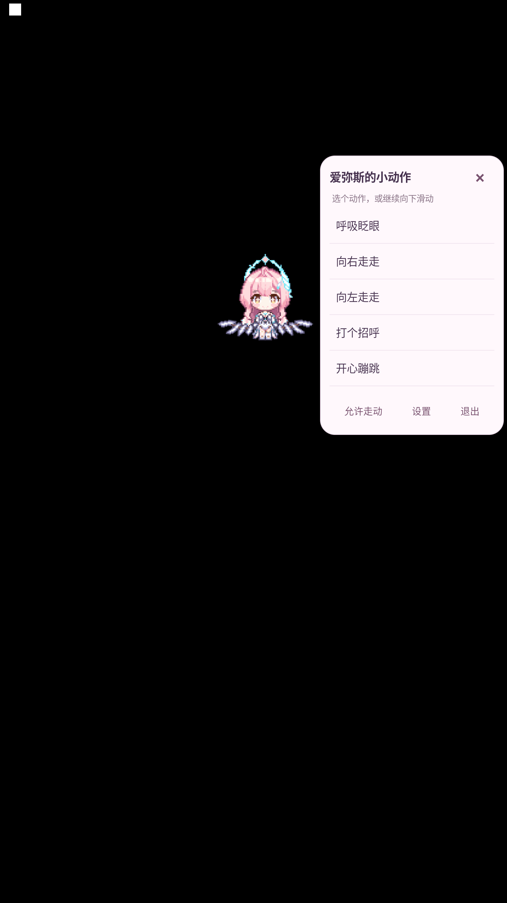

# 爱弥斯口袋桌宠 · Aemeath Pocket

一只可以陪你使用手机、看视频和玩游戏的安卓悬浮桌宠，使用《鸣潮》爱弥斯的像素动画。本项目是独立的本地安卓应用，关闭设置页面后，桌宠仍然显示在其他应用上方。

**当前版本：0.1.2 个人测试版，支持 Android 8.0 及以上。** 无需 DSH、Codex 或 AI 接口，应用没有申请网络权限。

## 安装与使用

1. 从 [Releases](https://github.com/LACANIA/aemeath-pocket/releases) 下载 `Aemeath-Pocket-0.1.2-test.apk`，在安卓手机上安装。
2. 打开应用，点击“让爱弥斯出来”，按提示允许显示悬浮窗；Android 13 及以上建议同时允许通知。
3. 返回桌面或打开其他应用。按住宠物拖动可以换位置；默认松手停止，应用内开启“拖拽抛射”后，快速拖动松手会惯性飞出并在屏幕边缘弹跳，速度逐渐减小。再次按住可以停止，关闭开关也会停止抛射。
4. 原地按住约 **0.6 秒后松手**，打开动作菜单。短按、拖动、拖动后返回原位都不会打开菜单；原地按住后再开始拖动，也按拖动处理。
5. 菜单可以选择动作、切换自主走动、打开设置或退出。应用里还可以调整大小、预览动作和重置位置。

部分手机需要在电池管理中允许后台运行。系统“强行停止”会结束桌宠；菜单“退出”或应用“收起桌宠”也会立即结束显示。

### 调节抛射手感

应用内点击“调整抛射参数”，可以展开以下四项滑块，关闭抛射后也可以提前调节：

| 参数 | 默认值 | 影响 |
| --- | --- | --- |
| 抛射力度 | 1.00× | 相同手势抛出的初始速度 |
| 反弹弹性 | 78% | 碰到边缘或落地后保留的速度比例 |
| 重力 | 1400 dp/s² | 朝当前画面下方的加速度 |
| 地面摩擦 | 2.5 /s | 落地后的水平减速程度 |

参数自动保存在本机，“恢复默认抛射参数”可以同时恢复四项设置。调整参数时会中断当前抛射。屏幕旋转时先停止旧方向的飞行，再按新的屏幕尺寸和安全区域计算位置，之后的抛射以当前画面下边缘为地面。



### 已安装旧版如何更新

下载新版 APK 后直接选择“更新”或“覆盖安装”，无需卸载旧版，宠物大小、位置和已有开关设置会保留。本项目发布的测试版沿用相同应用标识与签名证书；第一次升级到含抛射功能的版本时，“拖拽抛射”默认关闭。应用当前不提供自动检查更新，请从 Releases 获取新版。

### 玩游戏时使用点击穿透

开启应用里的“点击穿透”后，宠物会稍微变淡，窗口透明度为 75%。点击、长按和拖动直接交给下面的应用，宠物不会响应这些操作，已展开的动作菜单也会关闭。

可以回到应用关闭“点击穿透”，或者在允许通知的情况下，通过桌宠通知里的“恢复触控”恢复操作。具体游戏和手机系统是否允许悬浮显示，需要在自己的设备上试用。

## 动作与界面

包含 13 个动作条目：呼吸眨眼、向右走走、向左走走、打个招呼、开心蹦跳、困惑冒泡、墨镜摇摆、开心摆手、害羞眨眼、好奇张望、安静发呆、偷偷打盹、开心冒头。其中左右走动分别列出，整合后保存 126 个唯一透明帧。

菜单贴近宠物显示，动作列表可以内部滚动，走动、设置和退出按钮固定在底部。拖动、自主走动、调整大小和旋转屏幕时，宠物整体限制在可用屏幕范围内。



## 测试范围

目前在本地 MuMu Android 12 / API 32 模拟器完成了以下检查：

- 素材透明度、有效帧、动作映射和 Android 权限清单。
- 屏幕边界、位置保存和横竖屏切换。
- 16 项手势判定用例，以及短按、短暂按住、原地长按、长按后拖动、拖动返回原位的实际操作。
- 抛射速度估算、边缘反弹和 96 组边界轨迹用例；模拟器实测独立开关、慢速放下、快速甩动、反弹、飞行结束与设置保存。
- 四项滑块修改与重启后保留、一键恢复默认、参数面板旋转后恢复；飞行中旋转会中断旧轨迹，新抛射朝当前画面下边缘落下。
- 四个屏幕角落的菜单位置、动作列表滚动、关闭设置页后继续显示，以及退出时结束服务。
- 宠物覆盖另一应用的“显示”入口，开启穿透后可以点击进入下面的系统设置页面，关闭开关后恢复宠物触控。

模拟器无法展开通知栏或进入真实休眠，因此**通知栏恢复触控、锁屏暂停，以及实体手机和其他 Android 版本仍需验证**。当前安装包使用个人测试证书，不属于应用商店正式版本。

## 从源码构建

源码已经包含运行所需的动画图集，无需先下载上游仓库。构建脚本不依赖 Gradle，使用 Android SDK 官方工具。

推荐环境：Linux / WSL、Python 3.10 及以上、JDK 17、Android SDK Platform 35 和 Build Tools 35.0.0。Android Studio 的 SDK Manager 也可以准备这些 SDK 组件。

```bash
export JAVA_HOME=/path/to/jdk-17
export ANDROID_HOME=/path/to/android-sdk
python3 tools/build.py
```

输出为 `dist/Aemeath-Pocket-0.1.2-test.apk`。首次构建会在本机生成 `tools/personal-test.keystore`，只用于个人测试；该文件不会提交到仓库。同一设备继续覆盖安装时需要使用相同证书，请自行备份本机证书。重新生成证书的安装包无法直接覆盖使用旧证书的安装包。

也可以使用本地隔离工具目录：已有的 `tools/prepare-toolchain.sh`、`tools/prepare-sdk.py` 用于本项目早期 Ubuntu 测试环境，其特定 JDK 包版本取决于发行版软件源是否仍然提供。日常构建建议通过上面的环境变量指定自己安装的 JDK 与 SDK。

### 运行基础检查

```bash
python3 -m pip install -r requirements-dev.txt
python3 tools/verify-assets.py
python3 tools/test.py
```

模拟器交互脚本会操作选定设备的界面，只应在专门的测试模拟器运行。通过 `ADB` 指定 adb 路径、`ANDROID_SERIAL` 指定设备，再运行 `tools/compact-menu-test.py` 或 `tools/click-through-test.py`。后者针对中文 Android 设置页面；`tools/rotation-test.py` 额外需要 `MUMU_MANAGER` 指向 MuMuManager。

### 重新整合素材

如需重建图集，在本项目旁边准备两个参考仓库：

```bash
git clone https://github.com/culture-flask/dsh-aemeath-pet ../aemeath-culture-reference
git clone https://github.com/hachimi-ai/dsh-aemeath ../aemeath-hachimi-reference
python3 tools/merge-assets.py
```

脚本保留原始 GIF 帧与时序，加入扩展表情，去重相同像素帧，并生成动作配置与 `merge-report.json`。上游素材改变时，输出也可能改变。

## 素材来源与许可

安卓应用原创代码采用 [MIT](LICENSE)。动画整合自 [hachimi-ai/dsh-aemeath](https://github.com/hachimi-ai/dsh-aemeath) 和 [culture-flask/dsh-aemeath-pet](https://github.com/culture-flask/dsh-aemeath-pet)，感谢相关项目与原始表情包作者。

拖拽抛射算法移植自 [PC2005-cloud/dsh-pet](https://github.com/PC2005-cloud/dsh-pet) 的共享物理模块，复用松手速度估算、重力、反弹和地面摩擦，保留上游 MIT 许可与署名。手机端加入屏幕密度换算和完整窗口边界限制。

爱弥斯及《鸣潮》相关视觉设计归 Kuro Games / 相应权利方所有。本项目为非官方、非商业的同人适配，代码许可不涵盖角色和原始美术素材，也不授予额外商业使用许可。完整来源与使用说明见 [THIRD_PARTY_NOTICES.md](THIRD_PARTY_NOTICES.md)。
