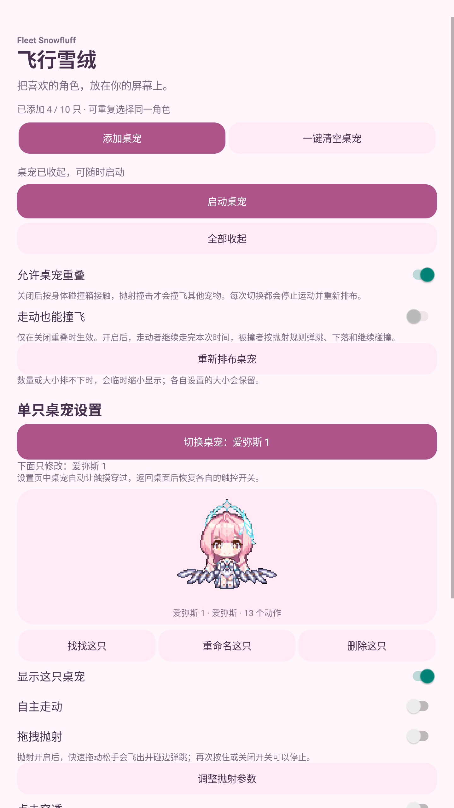

# 飞行雪绒 · Fleet Snowfluff

可以同时放出多只角色的安卓悬浮桌宠，现有爱弥斯、菲比、守岸人和弗洛洛。每只宠物分别设置，支持拖动、抛射弹跳和点击穿透；关闭设置页面后，仍可显示在桌面和其他应用上方。

**当前版本：0.2.2 个人测试版，支持 Android 8.0 及以上。** 原名“爱弥斯口袋桌宠”，仓库现名 `Fleet-Snowfluff-Aemeath`。纯本地运行，无需 DSH、Codex 或 AI 接口，应用没有申请网络权限。目前仅提供安卓版本。

[下载 v0.2.2 安卓安装包](https://github.com/LACANIA/Fleet-Snowfluff-Aemeath/releases/download/v0.2.2/Fleet-Snowfluff-0.2.2-test.apk) · [版本说明与历史安装包](https://github.com/LACANIA/Fleet-Snowfluff-Aemeath/releases)

## 界面与效果

以下是本地 MuMu Android 12 模拟器的实际截图；手机系统、屏幕比例和悬浮窗设置可能影响显示。

| 应用外观 | 多角色桌面外观 |
| --- | --- |
|  |  |

## 安装与使用

1. 从 [Releases](https://github.com/LACANIA/Fleet-Snowfluff-Aemeath/releases) 下载 `Fleet-Snowfluff-0.2.2-test.apk`，在安卓手机上安装；旧版用户直接覆盖更新。
2. 打开“飞行雪绒”，点击“添加桌宠”选择角色与数量，再点击“启动桌宠”，按提示允许显示悬浮窗；Android 13 及以上建议同时允许通知。
3. 返回桌面或打开其他应用。按住宠物拖动可以换位置；默认松手停止，应用内开启“拖拽抛射”后，快速拖动松手会惯性飞出并在屏幕边缘弹跳，速度逐渐减小。再次按住可以停止，关闭开关也会停止抛射。
4. 原地按住约 **0.6 秒后松手**，打开动作菜单。短按、拖动、拖动后返回原位都不会打开菜单；原地按住后再开始拖动，也按拖动处理。
5. 长按菜单可以选择动作、切换自主走动、打开这一只的设置或收起这一只。应用里的“全部收起”结束全部显示，“一键清空桌宠”还会清空列表，需要确认。

部分手机需要在电池管理中允许后台运行。系统“强行停止”会结束桌宠；清空列表后重新打开应用，也不会自动添加宠物。

### 多只宠物与独立设置

最多添加 **10 只**，可以同时选择不同角色，也可以添加多个相同角色。每只都有自己的名称、显示开关、大小、透明度、点击穿透、自主走动、抛射开关和四项物理参数。

在“单只桌宠设置”中点击 **“切换桌宠：角色名称”**，从列表选择需要修改的那一只；下方“下面只修改”会标明对象。“找找这只”会打断当前动作，在对应宠物上显示名称和闪烁边框，并临时减少透明感；爱弥斯会直接招手，约 1 秒后恢复原透明度与正常待机。其他角色按现有素材显示动作；已收起的宠物会提示先开启显示。进入设置页面时，宠物暂时让触摸穿过；离开页面后恢复各自的触控设置，已保存的开关不会被改写。

“允许桌宠重叠”开启时可以互相穿过，关闭时按身体碰撞箱接触。默认只有抛射撞击会让其他宠物进入飞行，普通走动遇到宠物会转向避让，保留对方的动作。双方的反弹弹性共同决定撞飞力度。**每次切换都会停止当前运动，并把所有显示中的宠物重新排到互不重叠的位置**。也可以点击“重新排布桌宠”；如果屏幕空间不足，会临时缩小显示，各自设置的大小仍然保留。

“走动也能撞飞”默认关闭，关闭重叠后才可使用。开启时，走动者继续按本次动作的原定时间走动，不因撞击重新计时或主动进入抛射；被撞者则按完整抛射规则弹跳、下落，也能继续撞飞其他宠物。走动按时间结束，不要求走完固定距离；普通接触不会反复重置动作播放。

### 调节抛射手感

应用内点击“调整抛射参数”，可以展开以下四项滑块，关闭抛射后也可以提前调节：

| 参数 | 默认值 | 影响 |
| --- | --- | --- |
| 抛射力度 | 1.00× | 相同手势抛出的初始速度 |
| 反弹弹性 | 78% | 碰到边缘或落地后保留的速度比例 |
| 重力 | 1400 dp/s² | 朝当前画面下方的加速度 |
| 地面摩擦 | 2.5 /s | 落地后的水平减速程度 |

参数自动保存在本机，“恢复这只的默认参数”仅恢复当前宠物的四项设置。调整参数时会中断当前抛射。屏幕旋转时先停止旧方向的飞行，再按新的屏幕尺寸和安全区域计算位置，之后的抛射以当前画面下边缘为地面。

### 已安装旧版如何更新

下载新版 APK 后直接选择“更新”或“覆盖安装”，无需卸载旧版。本项目发布的测试版沿用相同应用标识与签名证书；从 0.1.x 升级时，原有爱弥斯迁移为“爱弥斯 1”，保留大小、位置、开关及抛射参数。应用当前不提供自动检查更新，请从 Releases 获取新版。

### 玩游戏时使用点击穿透

开启选中宠物的“点击穿透”后，点击、长按和拖动直接交给下面的应用，宠物不会响应这些操作，已展开的动作菜单也会关闭。“透明度”滑块控制显示浓淡；多只穿透窗口同时显示时，会自动降低浓度以符合 Android 对同一应用悬浮窗的触摸限制，因此可能比滑块指定的更淡。

可以回到应用关闭这一只的“点击穿透”，或者通过桌宠通知里的“恢复全部触控”恢复所有宠物的操作。具体游戏和手机系统是否允许悬浮显示，需要在自己的设备上试用。

### 偶尔说一句话

“随机小气泡”默认关闭。开启后，待机时约每 45–90 秒出现一句短话，每次约 4.5 秒；部分手动动作和抛射结束时也有对应的小反应。设置里的“看看台词气泡”可以立即预览。

目前只有爱弥斯配置了随机台词，其余角色的这个选项暂时不可用。台词存放在 `app/src/main/assets/chatter.json`，游戏语音短句和原创二创文案分别标注，均在本地选取。气泡始终点击穿透，避开宠物窗口；没有合适显示位置时隐藏。拖动、展开菜单、锁屏和旋转时也会收起。

## 动作与界面

各角色按现有素材提供动作，不会全部拥有相同动作：

| 角色 | 动作条目 | 示例 |
| --- | ---: | --- |
| 爱弥斯 | 13 | 呼吸眨眼、左右走动、招呼、蹦跳、摇摆、打盹 |
| 菲比 | 5 | 呼吸眨眼、伸手、吃东西、说话、打盹 |
| 守岸人 | 1 | 安静待机 |
| 弗洛洛 | 9 | 待机、左右走动、招呼、打字、张望等 |

菜单贴近宠物显示，动作列表可以内部滚动，走动、设置和收起按钮固定在底部。拖动、自主走动、调整大小和旋转屏幕时，宠物整体限制在可用屏幕范围内。

## 测试范围

目前在本地 MuMu Android 12 / API 32 模拟器完成了以下检查：

- 素材透明度、有效帧、动作映射和 Android 权限清单。
- v0.2.0 四角色和同角色重复显示、爱弥斯与菲比独立保存透明度/点击穿透/抛射力度、重启保留、设置页临时穿透、10 只上限、双向切换重叠时重新排布，以及清空后重启保持空列表。
- 使用独立测试应用验证旧版设置迁移；200 组多宠物排布、碰撞能量与透明度限制，以及普通接触与可选走动撞飞连锁的纯逻辑检查通过。
- v0.2.1 模拟器实测普通接触只阻挡、走动撞飞时保持动作与原定结束时间、被撞者继续撞飞下一只，重叠开关联动，以及仅标记指定宠物、打断走动进行招手、1 秒后恢复透明度的定位效果。
- 屏幕边界、位置保存和横竖屏切换。
- 16 项手势判定用例，以及短按、短暂按住、原地长按、长按后拖动、拖动返回原位的实际操作。
- 抛射速度估算、边缘反弹和 96 组边界轨迹用例；模拟器实测独立开关、慢速放下、快速甩动、反弹、飞行结束与设置保存。
- 四项滑块修改与重启后保留、一键恢复默认、参数面板旋转后恢复；飞行中旋转会中断旧轨迹，新抛射朝当前画面下边缘落下。
- 四个屏幕角落的菜单位置、动作列表滚动、关闭设置页后继续显示，以及退出时结束服务。
- 使用不同 Android 用户标识的独立测试页面，确认宠物和气泡实际可见时，覆盖位置的按钮仍能收到点击；关闭宠物穿透开关后恢复宠物触控。

针对熄屏后无法重新显示的问题，增加了解锁、屏幕状态变化和应用重新启动时的恢复检查。模拟器无法完成真实休眠，因此**熄屏恢复、通知栏恢复触控，以及实体手机和其他 Android 版本仍需验证**。当前安装包使用个人测试证书，不属于应用商店正式版本。

## 从源码构建

源码已经包含运行所需的动画图集，无需先下载上游仓库。构建脚本不依赖 Gradle，使用 Android SDK 官方工具。

推荐环境：Linux / WSL、Python 3.10 及以上、JDK 17、Android SDK Platform 35 和 Build Tools 35.0.0。Android Studio 的 SDK Manager 也可以准备这些 SDK 组件。

```bash
export JAVA_HOME=/path/to/jdk-17
export ANDROID_HOME=/path/to/android-sdk
python3 tools/build.py
```

输出为 `dist/Fleet-Snowfluff-0.2.2-test.apk`。首次构建会在本机生成 `tools/personal-test.keystore`，只用于个人测试；该文件不会提交到仓库。同一设备继续覆盖安装时需要使用相同证书，请自行备份本机证书。重新生成证书的安装包无法直接覆盖使用旧证书的安装包。

也可以使用本地隔离工具目录：已有的 `tools/prepare-toolchain.sh`、`tools/prepare-sdk.py` 用于本项目早期 Ubuntu 测试环境，其特定 JDK 包版本取决于发行版软件源是否仍然提供。日常构建建议通过上面的环境变量指定自己安装的 JDK 与 SDK。

### 运行基础检查

```bash
python3 -m pip install -r requirements-dev.txt
python3 tools/verify-assets.py
python3 tools/test.py
```

模拟器交互脚本会操作选定设备的界面，只应在专门的测试模拟器运行。通过 `ADB` 指定 adb 路径、`ANDROID_SERIAL` 指定设备。v0.2.0 的 `tools/multi-test.py` 使用独立的 `.test` 应用标识，检查迁移、多角色和独立配置；需先构建测试包：

```bash
python3 tools/build.py --test-variant
python3 tools/build-probe.py --legacy-seed
python3 tools/multi-test.py
```

`tools/collision-test.py` 进一步检查普通接触、走动撞飞时的原始动作期限、被撞者继续传递抛射碰撞，以及开关联动，同样使用独立测试包。

这些脚本会清理测试应用的数据并暂时停止现用桌宠，完成后重新打开现用应用，不清空其数据。`tools/capture-docs.py` 同样使用独立测试包截取说明图片，结束后卸载测试应用。旧的单宠物交互脚本对应 0.1.x 界面，仅供参考。

另有 `tools/build-probe.py` 构建不同 Android 用户标识的点击测试页面，供触摸穿透检查使用。测试应用没有网络或其他权限，不随发行版提供。

### 重新整合素材

如需重建图集，在本项目旁边准备两个参考仓库：

```bash
git clone https://github.com/culture-flask/dsh-aemeath-pet ../aemeath-culture-reference
git clone https://github.com/hachimi-ai/dsh-aemeath ../aemeath-hachimi-reference
python3 tools/merge-assets.py
```

脚本保留原始 GIF 帧与时序，加入扩展表情，去重相同像素帧，并生成动作配置与 `merge-report.json`。上游素材改变时，输出也可能改变。

其余角色由 `tools/import-extra-characters.py` 和 `tools/import-phoebe.py` 转换，输入放在本地忽略的 `tools/downloads/`。菲比输入为 `phoebe/{idle,push,eating,talk,sleep}.gif`；守岸人为 `shorekeeper/frame_01.png` 至 `frame_24.png`；弗洛洛为 `phrolova/` 下的九个原始 GIF。输入版本和转换信息记录在每个角色目录的 `conversion-report.json`。普通构建无需重新转换素材。

## 致谢

- 爱弥斯：[hachimi-ai/dsh-aemeath](https://github.com/hachimi-ai/dsh-aemeath)、[culture-flask/dsh-aemeath-pet](https://github.com/culture-flask/dsh-aemeath-pet)，及原始表情包作者 [Neuro音乐](https://www.bilibili.com/opus/1167003396733927448)。
- 菲比：[llors-chen/Feibi_desktop](https://github.com/llors-chen/Feibi_desktop)。
- 守岸人：[ZxlDragonDoctor/desktop-pet--](https://github.com/ZxlDragonDoctor/desktop-pet--)。
- 弗洛洛：[sherlidian01-web/Phrolova-codex-pet](https://github.com/sherlidian01-web/Phrolova-codex-pet)。
- 抛射物理：[PC2005-cloud/dsh-pet](https://github.com/PC2005-cloud/dsh-pet)。

原创代码采用 [MIT](LICENSE)；《鸣潮》角色与原美术权利归 Kuro Games 及相应权利方，代码许可不涵盖这些素材。[随附许可说明](THIRD_PARTY_NOTICES.md)。
